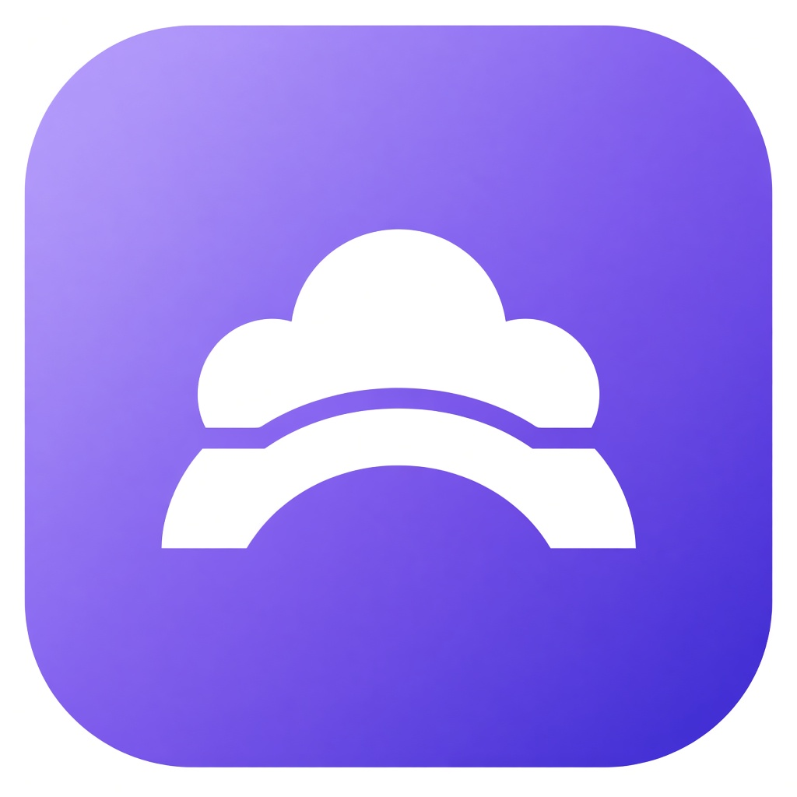
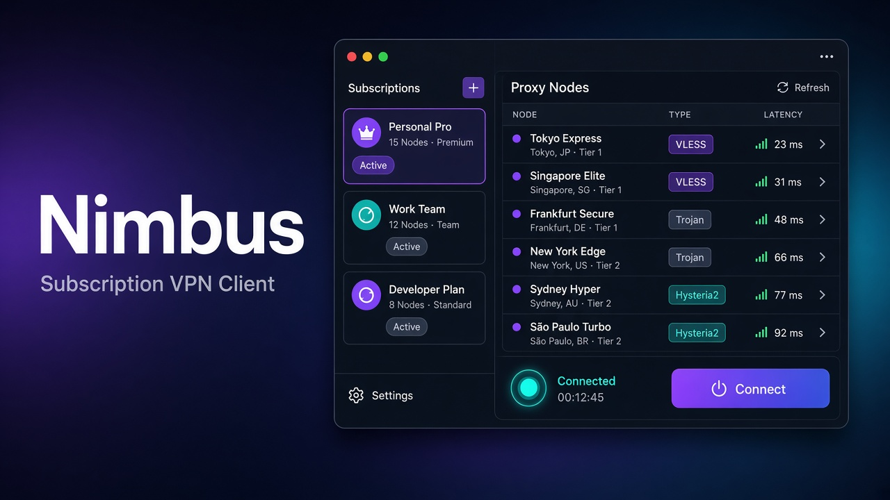

<p align="center">
  
</p>

<h1 align="center">Nimbus</h1>

<p align="center">
  <strong>Subscription VPN &amp; proxy client</strong> — Happ / Incy style.<br>
  Embedded web UI · sing-box core · VLESS Reality · VMess · Trojan · Shadowsocks · Hysteria2 · TUIC · Clash
</p>

<p align="center">
  <a href="https://github.com/WinSCP-Project/Nimbus/releases"></a>
  <a href="https://github.com/WinSCP-Project/Nimbus/blob/main/LICENSE"></a>
  
  
  
</p>

<p align="center">
  
</p>

**Nimbus** is a self-hosted **VPN client** and **proxy client** for subscription URLs. One binary, local web UI, [sing-box](https://sing-box.sagernet.org/) as the engine. Import the same share links people use in Happ, Incy, v2rayN, Clash Meta and Hiddify.

Ключевые слова: VPN, proxy, V2Ray, Xray, sing-box, VLESS, Reality, VMess, Trojan, Shadowsocks, Hysteria2, TUIC, Clash YAML, subscription, TUN, SOCKS5, HTTP proxy.

## Features

- Add / update / delete **subscription** URLs (`subscription-userinfo` quota, interval refresh)
- Paste share links: `vless://` `vmess://` `trojan://` `ss://` `hysteria2://` `hy2://` `tuic://` `socks://` `wireguard://` `anytls://`
- Import **Clash YAML** (`proxies:`) and **sing-box JSON** (`outbounds`)
- Node table: search, protocol filter, TCP ping, select, connect
- Routing modes: **rule** / **global** / **direct**
- Local **mixed inbound** (SOCKS5 + HTTP) on port `10808`
- Optional **TUN** (needs admin/root)
- Live traffic, logs, SSE state stream
- Auto-download sing-box on first connect

## Protocols

| Protocol | Notes |
|----------|--------|
| VLESS | TCP / WS / gRPC / HTTPUpgrade, TLS, **Reality**, uTLS, flow `xtls-rprx-vision` |
| VMess | WS, TLS, fingerprint |
| Trojan | WS / gRPC, TLS |
| Shadowsocks | SIP002 + legacy base64, plugins |
| Hysteria / Hysteria2 | obfs, port hop (`mport`) |
| TUIC | congestion, UDP relay |
| SOCKS / HTTP | optional auth |
| WireGuard | keys, reserved, MTU |
| AnyTLS | SNI, fingerprint |

## Install

Release binaries: [Nimbus releases](https://github.com/WinSCP-Project/Nimbus/releases).

```bash
# Linux
chmod +x nimbus-linux-amd64
./nimbus-linux-amd64 -listen 127.0.0.1:8787

# Windows
nimbus-windows-amd64.exe -listen 127.0.0.1:8787
```

Open **http://127.0.0.1:8787**

From source:

```bash
git clone https://github.com/WinSCP-Project/Nimbus.git
cd Nimbus
go test ./...
go build -o nimbus .
./nimbus -listen 127.0.0.1:8787
```

Data dir: `~/.nimbus/` (`state.json`, sing-box binary, logs). After **Connect**, point the system or browser at mixed proxy **127.0.0.1:10808**.

## Flags

| Flag | Meaning |
|------|---------|
| `-data` | state + core directory |
| `-listen` | UI bind address (overrides settings) |

## Routing

- **Rule** — private IPs (and a small CN suffix list) go direct, everything else through the node
- **Global** — all traffic through the selected node
- **Direct** — no proxy

## HTTP API

| Method | Path | Body |
|--------|------|------|
| GET | `/api/state` | |
| PUT | `/api/settings` | settings JSON |
| POST | `/api/subscriptions` | `{name,url,user_agent}` |
| POST | `/api/subscriptions/{id}/update` | |
| DELETE | `/api/subscriptions/{id}` | |
| POST | `/api/import` | `{sub_id,text}` |
| POST | `/api/nodes/select` | `{id}` |
| POST | `/api/connect` | `{id}` |
| POST | `/api/disconnect` | |
| POST | `/api/ping` | `{id}` |
| POST | `/api/ping-all` | |
| GET | `/api/logs` | |
| GET | `/api/events` | SSE |

## Why Nimbus

Lightweight alternative to Happ, Incy, v2rayN and Clash Verge when you want a **single Go binary**, a browser UI, and a real **sing-box** dataplane — not an Electron shell. Built for people who already have a subscription and need a clean desktop/Linux client.

## License

MIT. See [LICENSE](LICENSE).
